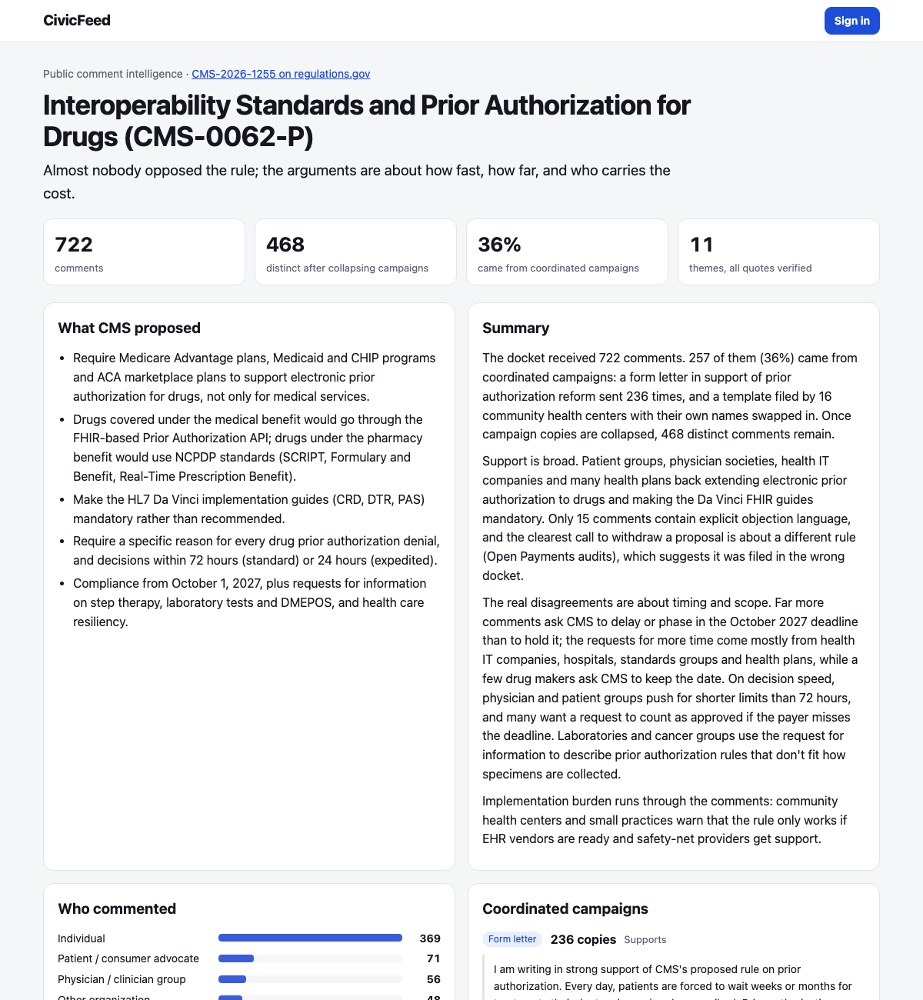

# CivicFeed

**Live: https://civicfeed-six.vercel.app**



**What did 722 public comments actually say about CMS's prior authorization rule?**

CivicFeed turns a federal rulemaking docket into a readable briefing:
- the coordinated campaigns;
- who commented;
- the main themes and where commenters disagree;
- quotes, each checked word for word against the original comment.

Signed-in users can star themes and comments and keep private notes.

First docket: **[CMS-2026-1255](https://www.regulations.gov/docket/CMS-2026-1255/comments),
Interoperability Standards and Prior Authorization for Drugs (CMS-0062-P).**

**Who feels the pain:** agency staff, who must consider every comment (3–6 person-weeks per
docket), and the journalists, advocates and analysts trying to follow a rule. **Who would
pay:** trade associations, advocacy groups and consultancies that track regulation,
and agencies that can't afford $100K+ tools.

## What it found

| | |
|---|---|
| Comments | 722 (468 distinct once campaigns are collapsed) |
| Coordinated campaigns | 36% of all comments: mainly one form letter sent 236 times and a shared template filed by 16 community health centers and their associations (each with its own name swapped in), plus a smaller form letter sent 5 times |
| Opposition | Almost none to the rule itself. The clearest "withdraw the proposal" comment is about Open Payments audits, a different rule, so it was probably misfiled. |
| Deadline debate | About 10 times more comments ask to delay or phase in the October 1, 2027 compliance date than to hold it. The requests for more time come mostly from health IT companies, hospitals, standards bodies and plans. |
| Decision speed | More comments ask for shorter limits than ask CMS to keep 72 hours / 24 hours, and 23 want a missed deadline to count as an approval. |

## How it works

```
fetch.py  →  prep.py (rules)  →  ANALYZE.md (AI)  →  build.py (checks + counts)  →  web UI
```

1. **`scripts/fetch.py`** downloads every comment from
   [Mirrulations](https://registry.opendata.aws/mirrulations/), a public AWS archive of
   regulations.gov that needs no API key. It includes text already extracted from PDF
   attachments, which matters: 377 of the 722 comments put their substance in an
   attachment.
2. **`scripts/prep.py`** (no AI):
   - **Form-letter campaigns:** 5-word shingles, 50% Jaccard, union-find.
   - **Template campaigns:** 6-word shingle overlap of 35% or more across organisations.
   - **Commenter type:** from the submitter category and organisation name.
   - **Stance:** from explicit wording.
   - **Key recommendation sentences.**
   - **Themes:** TF-IDF + k-means into 14 candidate clusters.
3. **[`ANALYZE.md`](ANALYZE.md)** is the AI step. Claude labels and merges the clusters,
   writes neutral summaries, picks quotes and defines the regex for each debate's
   sides, and writes **no numbers**. The output is `data/<docket>/analysis.json`. It
   can be re-run by Claude Code or by a scheduled Claude routine.
4. **`scripts/build.py`:**
   - **rejects any quote** that doesn't appear word for word in the cited comment
     (22 of 22 pass);
   - computes every count, debate split and stakeholder breakdown;
   - writes `report.json` for the UI.
5. **UI:**
   - static HTML/JS;
   - accounts through **Supabase Auth** (email and password);
   - a `cf_notes` table with row-level security, so users only ever see their own
     rows. This was tested in the database: another user can't read, edit or delete
     your notes, and signed-out visitors see nothing.

## Privacy

Individual commenters' names are public record on regulations.gov, but CivicFeed doesn't
publish them:
- the browser shows organisation names only;
- "My name is …" is redacted from excerpts;
- the raw `comments.json`, which contains names, isn't committed.

## Run it

```sh
python3 -m venv .venv && .venv/bin/pip install scikit-learn==1.5.2 numpy
python3 scripts/fetch.py CMS-2026-1255          # ~1 min, writes data/<docket>/comments.json
.venv/bin/python scripts/prep.py CMS-2026-1255  # rules, themes
# AI step: follow ANALYZE.md to write data/<docket>/analysis.json
.venv/bin/python scripts/build.py CMS-2026-1255 # checks quotes, writes report.json
python3 -m http.server 8000
```

## Limits

- **Commenter type and stance are rule-based estimates.** About 7% of organisations end
  up as "Other". "Objection language" often objects to prior authorization in general,
  not to this rule.
- **Debate counts are pattern matches** and include a few false hits (for example,
  unrelated uses of "glide path"). Every side links back to the comments, so you can
  check them.
- **One docket so far.** The pipeline is docket-agnostic, but each new docket needs the
  AI step and a review.

Built as Level 4 of a personal "vibe coding" practice roadmap. The data is public; the
project isn't affiliated with CMS.
